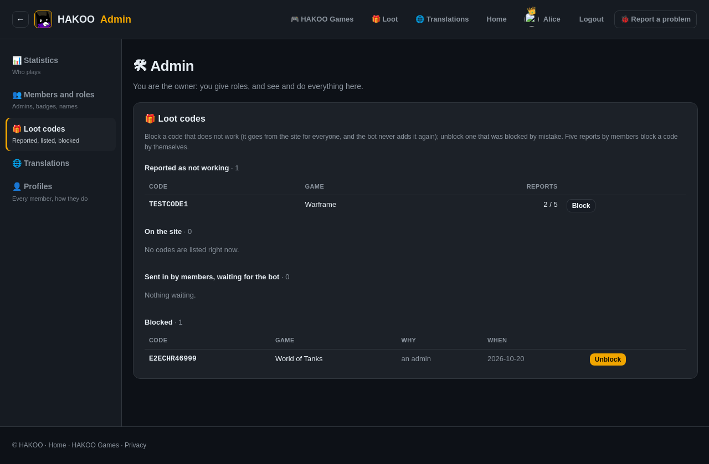
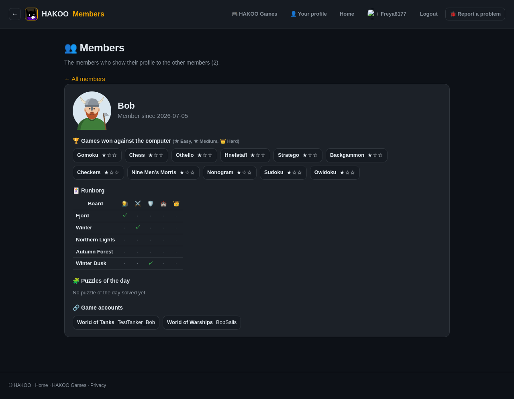
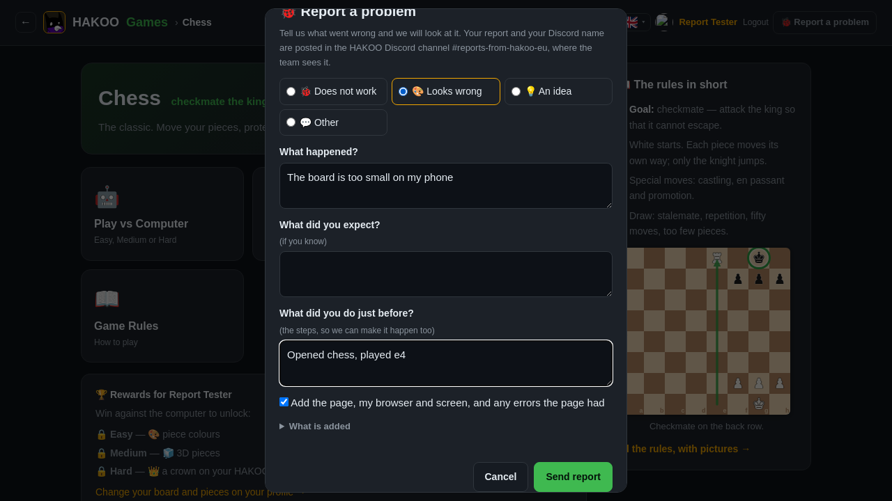
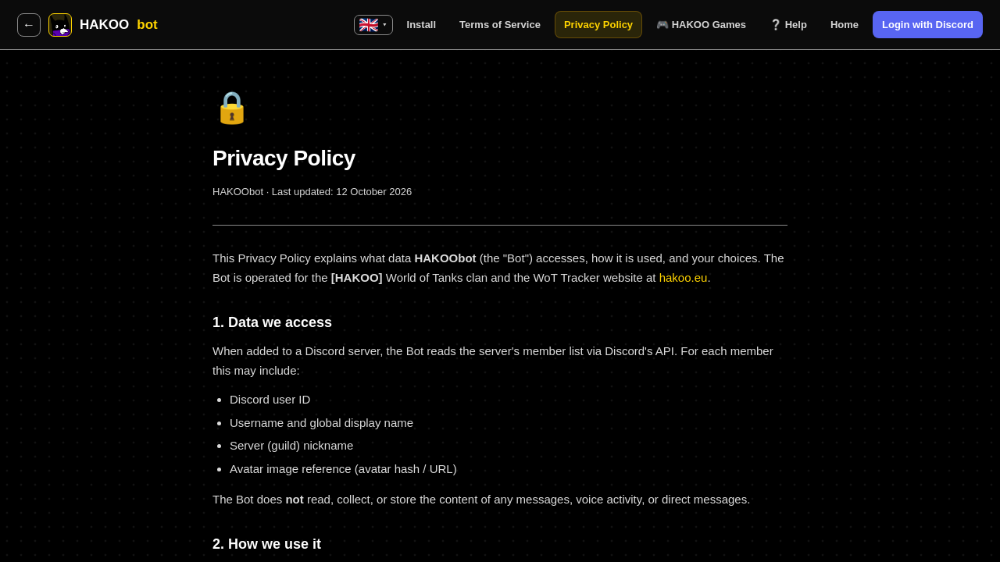
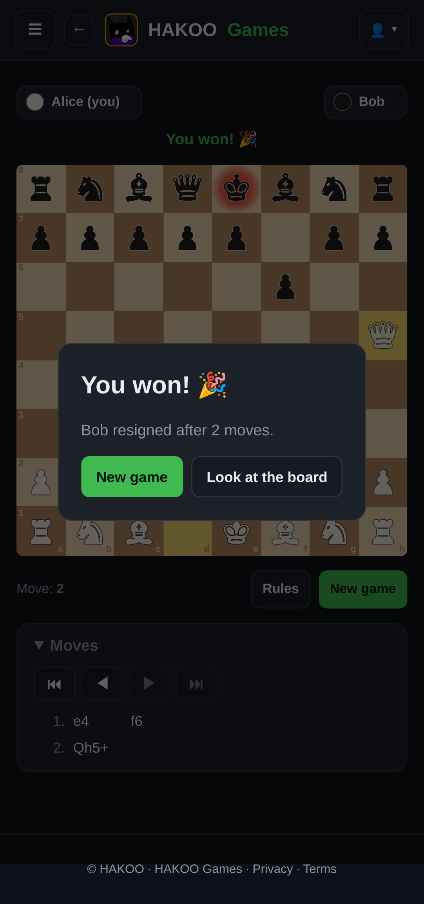
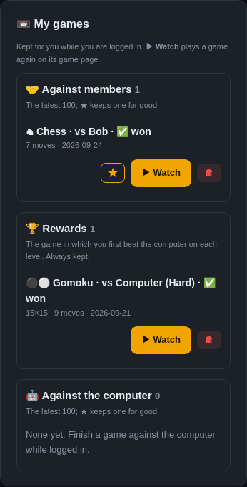
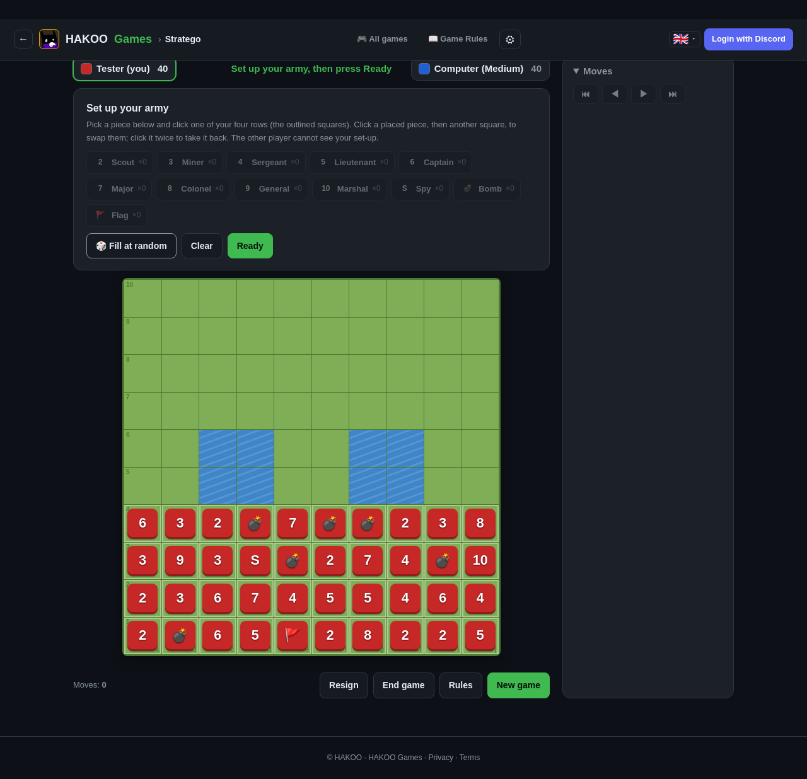
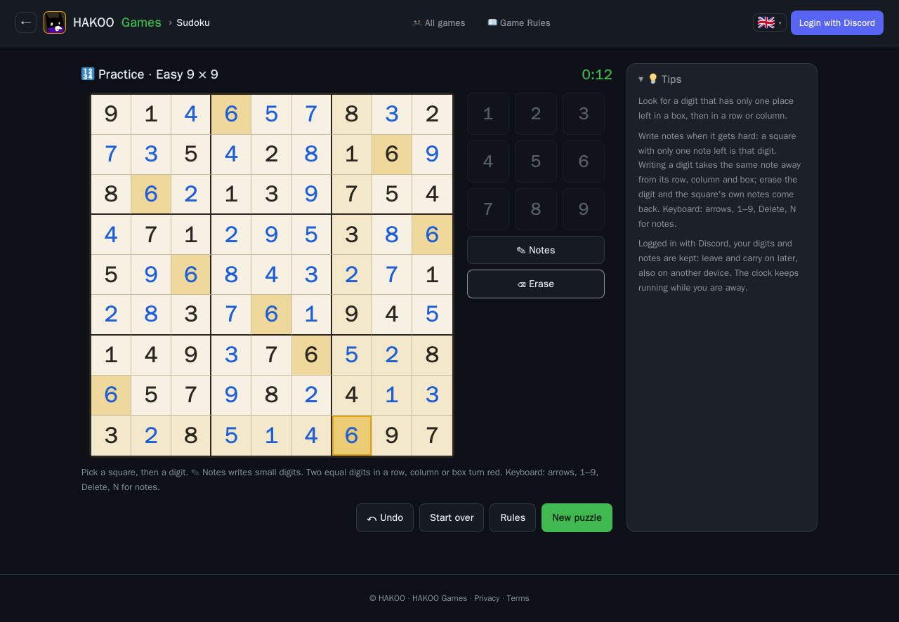

# Testresultat (urval)

Ett urval ur testkörningarna. Skärmbilderna tas automatiskt av Playwright-testerna i Chromium, Firefox och
en mobil vy. All data är fiktiv testdata.

- [integration-testdox.txt](integration-testdox.txt): PHPUnit-körning, 445 gröna tester grupperade per testklass

| Skärmbild | Vad testet visar |
|---|---|
|  | Adminsidan: rollstyrd åtkomst, bara ägaren ser allt |
|  | Medlemsprofil: visas bara för inloggade medlemmar som valt att visa profilen |
|  | Formuläret "Rapportera ett problem": tydlig information om vad som skickas (GDPR Art. 13) |
|  | Integritetspolicyn i högkontrasttema (tillgänglighet) |
|  | Schack mellan två medlemmar i mobil vy |
|  | Sparade spel i 390 px bredd (responsiv layout) |
|  | Stratego: uppställning mot datorn |
|  | Sudoku löst i Firefox |
